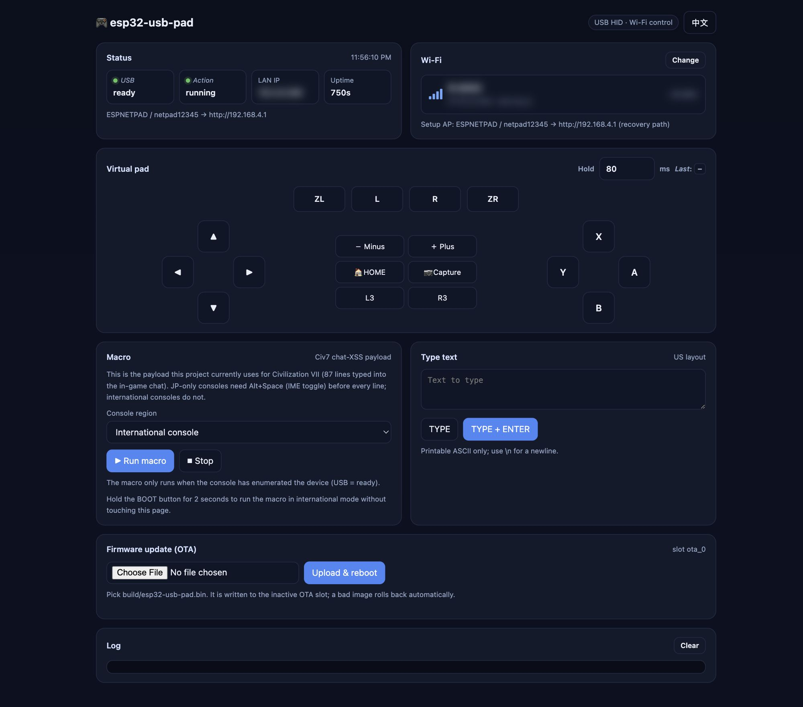

# CivSwitch

XSS toolchain for the Switch 1 edition of Civilization 7.  
Only the **1.0.0** version of the game in physical cartridge is supported.  

Every switch 1/2 firmware 20.x.x and up to current version (23.0.1) should work.  

Tested on Switch 1 fw 22.5.0, Switch 2 fw 20.4.0 and 23.0.1.  
`esp32-usb-pad` additionally tested on a JP-only Switch 2 20.4.0.

Three components:

- **PicoSwitch** — clean, compilable Pico firmware (RP2040 + RP2350) that types a chat-XSS payload into the Switch (USB HID macro).

  Default payload = the Remote JS Loader bootstrap (exploit core + TCP loader).

  Ships with `compress.js` (chat transport: terser -> deflateRaw -> base-25 chunked `img/onerror` lines with censor armor).
- **esp32-usb-pad** — the same USB HID macro for **ESP32-S3** instead of a Pico (composite gamepad + keyboard, same descriptors, same `payload.txt`). Builds with ESP-IDF; see `esp32-usb-pad/README.md`.
- **installer-creator** — given any JavaScript payload, produces the boot-persistent installer (`XSTRIG.Civ7Save` trigger written to savedata) to send through the Remote JS Loader.
- **esp32-ldn-civ7** — fully offline alternative: an ESP32-S3 joins the game's **local wireless** lobby and delivers the payload plus the persistent installer over LDN. No Wi-Fi/LAN, no USB HID typing, no language or layout changes; only your own `prod.keys` is needed. Recommended when the console cannot stay online (e.g. heavy DNS blocking). See `esp32-ldn-civ7/README.md`.

### esp32-ldn-civ7

**if you have an esp32-s3 board, goto [esp32-ldn-civ7](esp32-ldn-civ7/README.md)** to flash firmware and install now. the rest of this page is for other methods.


### esp32-usb-pad web UI



The ESP32-S3 firmware exposes a Wi-Fi control surface: status, connected Wi-Fi
and signal, the full virtual pad, the Civ7 macro (JP-only / international),
typing, and OTA updates. See
[`esp32-usb-pad/README.md`](esp32-usb-pad/README.md).

## Layout

`core.js` at the root is the shared payload both components build from, and `send_js.py` at the root sends any payload to a running loader.

## Workflow

[Video Tutorial](https://www.reddit.com/r/switch2hacks/comments/1xll4wf/civswitch_hack_start_to_finish/) from switch2hacks reddit

1. **Build + flash** the loader firmware — `PicoSwitch` (see `PicoSwitch/README.md`) or `esp32-usb-pad` (see `esp32-usb-pad/README.md`).

   On the Switch, go to "System" menu and change system language to English(US).  
   Go to "Controllers & Accessories" menu and change USB Keyboard to English(US).  

   These are required to type "English" letters (code) using USB keyboard.  
   (Higher fw might not need to change system language as they support typing english without language change)  
   
   NOTE for JP-only Switch2 :
   1. use a esp32-s3 board and check [Japanese consoles](#japanese-consoles-jp-only-switch-2) below.  
   2. If you have another Switch, you can also connect the two consoles via local
   wireless multiplayer and plug the Pico on the other device, letting it send
   the payload over the network.
   
   Connect to Internet using [90DNS](https://gitlab.com/a/90dns) to block Nintendo servers.  
   
   Then launch game and navigate main menu -> MULTIPLAYER -> WIRELESS -> CREATE GAME -> HOST LOBBY -> CHAT then plug the Pico in (in docked mode, focus the chat box first to receive Pico input).  

   The firmware types the chat XSS (~87 lines); the Remote JS Loader comes up on
   the console (TCP :9026) for that session. This takes ~7 min on ESP32-S3 and
   ~15 min on a Pico.
2. **Install the persistent boot trigger** from the PC, while the chat-XSS loader
   is still running (do not close the game first):

   ```sh
   cd installer-creator
   npm install            # once: terser is needed by compress_stage.js
   python install.py <console-ip>
   ```

   It uploads the save template, splices the compressed payload into it
   on-console, removes the previous `XSTRIG.Civ7Save` trigger only, and writes
   the new one.

3. From then on, every boot: main menu -> Load Game -> the payload runs from savedata (and if the payload is the loader, :9026 is up at boot — and survives console sleep/wake).  
4. You can revert system language after installer finished.  

## Japanese consoles (JP-only Switch 2)

**Only needed on a JP console.** On an English console the extra keystrokes are
skipped at runtime — no separate build.

On a JP console the chat input stays in Japanese IME mode, so plain ASCII
keystrokes open the candidate window and the payload arrives as kana — the XSS
never runs. `esp32-usb-pad` handles this at runtime; `PicoSwitch` has no IME
toggle and needs the console in English input mode.

| Build | JP handling |
|---|---|
| `PicoSwitch` | none — relies on the console's language/keyboard language being English |
| `esp32-usb-pad` | `Alt+Space` per line; pick **JP-only / International** in the web UI (`BOOTSTRAP jp` / `BOOTSTRAP intl`), saved in NVS |

`Alt+Space` toggles the IME to direct (English) input, so each line is typed as
literal ASCII. It is emitted **per line**, not once, because every payload line
is a fresh chat message: `Esc`, `A`, `Alt+Space`, type line, `Enter`, `Enter`.

Choose the region in the macro card of `http://<board-ip>/`, or from a shell:

```sh
python3 esp32-usb-pad/tools/netpad.py --host 10.2.0.240 macro   # uses saved region
printf 'SET REGION intl\n' | nc 10.2.0.240 9060                 # English console
```

Notes:

- The USB keyboard layout must be **English (US)** in
  *System Settings → Controllers and Accessories → USB Keyboard*. With the IME
  toggle the system language itself can stay Japanese.

## Sending payloads (`send_js.py`)

```
python send_js.py <console-ip> [port] file.js
```

Sends a JS file as-is to the Remote JS Loader (default port 9026), then prints the log output the console streams back (read until close or timeout).  

## Build (Pico firmware)

On Ubuntu 24.04:

```
sudo apt install -y git build-essential cmake ninja-build gcc-arm-none-eabi libnewlib-arm-none-eabi libstdc++-arm-none-eabi-newlib python3 nodejs npm
git clone --branch 2.3.1 --depth 1 --recurse-submodules --shallow-submodules https://github.com/raspberrypi/pico-sdk.git ~/pico-sdk
export PICO_SDK_PATH=$HOME/pico-sdk
cd PicoSwitch
npm install                    # terser for compress.js
node compress.js               # reads ../core.js -> payload.txt
cmake --preset pico2 && cmake --build --preset pico2    # RP2350 -> build-pico2/src/civ7-pico2.uf2
cmake --preset pico1 && cmake --build --preset pico1    # RP2040 -> build-pico1/src/civ7-pico1.uf2
```

## Build (ESP32 firmware)

Requires ESP-IDF v6.1 and an ESP32-S3 board with native USB (not ESP32 classic).

```
export IDF_PATH=~/esp/esp-idf
export IDF_TOOLS_PATH=~/.espressif
source "$IDF_PATH/export.sh"

cd PicoSwitch && npm install && node compress.js && cd ..   # writes PicoSwitch/payload.txt
cd esp32-usb-pad
idf.py set-target esp32s3
idf.py -DLANG_JP=0 build      # English console; use -DLANG_JP=1 on a JP-only console
idf.py -p /dev/cu.usbmodemXXXX flash   # hold BOOT while plugging the board in
```

`-DLANG_JP=1` adds an `Alt+Space` before every line so the JP IME switches to
direct input; on a JP-only console that is the only way to type the payload.
See [Japanese consoles](#japanese-consoles-jp-only-switch-2).

Flags are CMake cache values, e.g. `idf.py -DLANG_JP=0 -DMACRO_REPEAT=0 build`.
See `esp32-usb-pad/README.md` for wiring, timing, and troubleshooting.

## Credits

- Original [CivSwitch](https://github.com/Gezine/CivSwitch) project by
  [Gezine](https://github.com/Gezine) — exploit core, chat transport,
  PicoSwitch firmware and installer.
- The JS exploit core in `core.js` referenced [inject.js](https://github.com/NetflixNHack/Netflix-N-Hack/blob/main/inject.js) from [Netflix-N-Hack](https://github.com/NetflixNHack/Netflix-N-Hack) and its fork by [ufm42](https://github.com/ufm42/Netflix-N-Hack/blob/main/inject.js) 
- The PicoSwitch firmware is based on [Pico-Switch-Controller](https://github.com/Element2424/Pico-Switch-Controller) by [Element2424](https://github.com/Element2424)
- `esp32-ldn-civ7` ports the local-wireless path from
  [CivSwitchLDN](https://github.com/ItsNerisma/CivSwitchLDN) (GPL-3.0) and the
  ESP32 LDN radio technique from [pokeldn](https://github.com/Decryptu/pokeldn)
  (AGPL-3.0).
