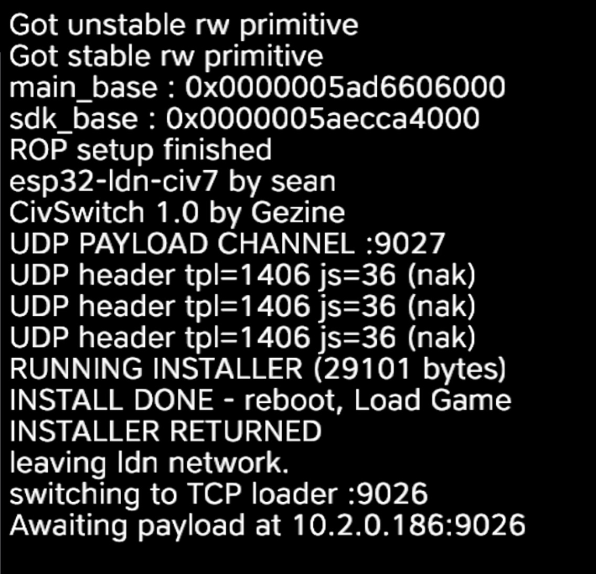

# esp32-ldn-civ7 — offline CivSwitch installer over Local Wireless (LDN)



An ESP32-S3 that joins the console's **Civ VII wireless lobby** and injects the
CivSwitch payload over **local wireless** — no PC, no USB HID typing, no Wi-Fi
or LAN access, and **no system-language or controller-layout changes**.

With the payload it also carries the full persistent installer (the 1 MB save
template), so one run does everything: exploit → installer → back to the normal
TCP loader on `:9026`.

## Why another board firmware?

`esp32-usb-pad` (the "net-pad") types the payload over a **USB HID keyboard**
and exposes a Wi-Fi web UI. It works for any game that needs autotyping, and it
is the right choice for future titles.

This firmware is **Civ VII specific** and is the recommended path today:

| | `esp32-usb-pad` (net-pad) | `esp32-ldn-civ7` (this) |
|---|---|---|
| Transport | USB HID typing | Civ VII wireless lobby (LDN) |
| Console setup | English/USB keyboard language, layout changes | none |
| PC required | for the web UI / installer upload | **no** |
| Network required | Wi-Fi (console + board) | **none** (LDN only) |
| Secrets | — | your own `prod.keys` (derived keys baked at build time) |
| Speed | ~7 minutes of typing | ~10-15 seconds |
| Works for other games | yes (autotyping) | no (Civ VII only) |

The LDN path matters when the console cannot reach the internet: a heavily
blocked DNS setup (e.g. 90DNS) makes the console refuse to stay online, so
anything that needs the console's LAN is unreliable. This firmware never leaves
the local-wireless link.

## Requirements

| Item | Value |
|---|---|
| Board | ESP32-S3, **16 MB flash** (4 MB works if you shrink the storage partition) |
| Toolchain | ESP-IDF **v6.1** |
| Host tools | Node.js (for `terser`), Python 3.10+ |
| Console | Switch 2, Civ VII **1.0.0 physical cartridge** (Switch 1 edition) |
| Keys | your own `prod.keys`, dumped from your own console |
| Game state | `MULTIPLAYER → WIRELESS → CREATE GAME → HOST LOBBY` |

`prod.keys` is **never committed** — `keys.h` is generated at build time and is
gitignored together with the payloads and blobs.

## One-click build + flash

```sh
cd CivSwitch/esp32-ldn-civ7
source /path/to/esp-idf/export.sh          # idf.py on PATH
python3 tools/build_and_flash.py \
    --keys /path/to/prod.keys \
    --port /dev/cu.usbmodem1234 \
    --flash
```

What it does:

1. `main/keys.h` from your `prod.keys` (`tools/make_keys.py`);
2. `main/chat_payload.h` from the **shared `../core.js`** + the UDP installer
   channel (`tools/make_payload.py`) — so an upstream CivSwitch update is picked
   up by rerunning this command;
3. `blobs/blob_tpl.bin` (save template, base64) and `blobs/blob_apply.bin`
   (installer JS, base64) via `tools/make_install_blobs.py`;
4. `idf.py build`;
5. `esptool write-flash`: bootloader + partition table + app + both blobs.

Options: `--erase` (full chip erase first), `--no-build` (regenerate assets
only), `--core path` (use a different `core.js`), `--port $ESPPORT`.

After flashing, **press RESET** on the board (esptool's reset can leave the chip
in ROM download mode).

## Run it

1. Start Civ VII and open `MULTIPLAYER → WIRELESS → CREATE GAME → HOST LOBBY`.
2. Power the board (USB power is enough; it does not need to be plugged into
   the console).
3. The board scans, joins, authenticates and sends the payload automatically.
4. The console shows (see the screenshot):

```text
esp32-ldn-civ7 by sean
CivSwitch 1.0 by Gezine
UDP PAYLOAD CHANNEL :9027
UDP header tpl=1406 js=36 (nak)
UDP header tpl=1406 js=36 (nak)
UDP header tpl=1406 js=36 (nak)
RUNNING INSTALLER (...)
INSTALL DONE - reboot, Load Game
INSTALLER RETURNED
leaving ldn network.
switching to TCP loader :9026
Awaiting payload at <console-ip>:9026
```

5. From here either:
   - keep using the loader (`python3 send_js.py <ip> 9026 payload.js`), or
   - restart the game and pick **Load Game** → the persistent `XSTRIG.Civ7Save`
     starts the loader again.

Each run needs a **fresh game**: the payload replaces the game's UI
(`document.body.innerHTML=''`), so the lobby cannot be reused.

## How it works

```text
scan LDN advertisements (channels 1/6/11)
  → derive advertise_key from prod.keys (AES-ECB + SHA-256)
  → decrypt the advertisement (AES-CTR, SHA-256 verified) → server_random
  → data key (CCMP) = KDF(server_random + Civ VII passphrase)
  → associate to the hidden SSID (no 4-way handshake, keys installed manually)
  → LDN authentication (challenge HMAC-SHA256)
  → IP from the host's advertisement (169.254.x.y)
  → ARP warmup, FireCONN → NetWelcome
  → 20 chat messages (core.js + UDP receiver), 0.2 s apart
  → console evals the payload and binds UDP :9027
  → board streams the installer (template + apply JS) over LDN in one pass
  → console NAKs only the missing chunks; the board resends just those
  → console starts the installer as soon as the last chunk arrives
  → console writes XSTRIG.Civ7Save, commits, then switches to the TCP loader :9026
```

## Layout

```text
esp32-ldn-civ7/
  CMakeLists.txt
  partitions.csv           app 1 MB + 2 MB storage for the installer blobs
  sdkconfig.defaults
  main/
    main.c                 scan/associate/auth/IP, drives civ7 + installer
    civ7.c/.h              Civ VII LDN protocol (transport, FireCONN, NetChat)
    installer.c/.h         streams the installer over UDP :9027
    private_wifi.h         ESP-IDF v6.1 wpa_funcs ABI (no 4-way handshake)
  tools/
    build_and_flash.py     one-click
    make_keys.py           prod.keys -> main/keys.h (gitignored)
    make_payload.py        ../core.js -> main/chat_payload.h (gitignored)
    make_install_blobs.py  installer -> blobs/ (gitignored)
    udp_loader.js          the UDP channel spliced into core.js
  blobs/                   generated
```

## Troubleshooting

| Symptom | Cause |
|---|---|
| `assoc attempt N did not associate` | lobby closed / wrong channel; re-create the lobby |
| `LDN authentication failed` | wrong `prod.keys` or the lobby changed |
| `no FireRPLY/NetWelcome` | the console left the lobby; restart the game |
| `UDP incomplete missT=...` | the board is re-sending; check `rx=` growth |
| `binding failed` / `udp bind failed` | port 9027 already in use in the game |
| Console shows nothing | the chat XSS did not render; check the lobby chat |
| Board not detected by esptool | hold BOOT, tap RESET, release BOOT |

## Notes

- `prod.keys` and everything derived from it (`main/keys.h`) stay offline.
- The installer blob contains the save template from `installer-creator`; it is
  regenerated from the repo, not copied around.
- The board never connects to your Wi-Fi in this firmware; after the run it is
  idle. Reset it for another attempt.

## Credits & license

This firmware ports the local-wireless path from these projects. Their licenses
apply to the ported parts; check them before redistributing a binary:

| Project | What was used | License |
|---|---|---|
| [CivSwitch](https://github.com/Gezine/CivSwitch) | payload, save template, installer design | MIT |
| [CivSwitchLDN](https://github.com/ItsNerisma/CivSwitchLDN) | LDN/Civ VII protocol flow, constants | GPL-3.0-only |
| [Kinnay LDN](https://github.com/kinnay/LDN) | key derivation, advertisement/auth format | GPL-3.0 |
| [pokeldn](https://github.com/Decryptu/pokeldn) | ESP32 `wpa_funcs` patch for handshake-less association | AGPL-3.0 |

`prod.keys` is never part of this repository; delete `main/keys.h`, `blobs/` and
`build/` before sharing a tree that was built on your own console.
